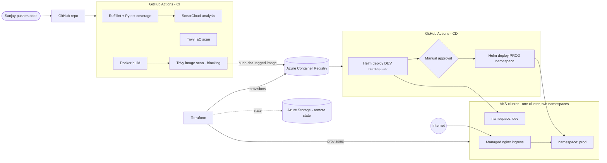
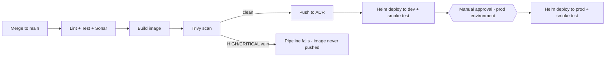

# Project 3 — Python App CI/CD on Azure AKS

**Author: Sanjay Naidu** · Platform Engineering portfolio project

Production-grade, end-to-end delivery pipeline for a Python (FastAPI) service on Azure Kubernetes Service — built deliberately on a free-trial budget to prove that *production-shaped* and *expensive* are not the same thing.

```
Python (FastAPI) · Docker · Terraform · GitHub Actions (OIDC) · SonarCloud · Trivy · ACR · AKS · Helm
```


---

## Architecture



**Pipeline flow on every merge to `main`:**



---

## Why each decision (the part interviewers ask about)

### Application

| Decision | Why |
|---|---|
| **FastAPI** | Modern async framework; free OpenAPI docs at `/docs` (great live demo); trivial to add health/metrics endpoints. |
| **Separate `/healthz` and `/readyz`** | Liveness ≠ readiness. A warming-up pod should stop *receiving traffic*, not get *restarted*. Conflating them causes restart storms. |
| **`/metrics` (Prometheus)** | Observability is a launch requirement, not an afterthought — even a demo app should expose the standard scrape endpoint. |
| **Version + environment on `/`** | After a deploy you can *prove* which build runs in which namespace — makes the CD demo tangible. |
| **Pinned dependencies + Dependabot** | Pins give reproducible builds; Dependabot PRs keep them fresh, and each bump rides the full test/scan pipeline. |

### Containerisation

| Decision | Why |
|---|---|
| **Multi-stage Dockerfile** | Build tooling never ships to production → smaller image, fewer CVEs for Trivy to find. |
| **`python:3.12-slim` base** | ~120 MB vs ~1 GB full image; smaller attack surface. |
| **Non-root user (UID 10001)** | Container escape mitigation; enforced again in the Helm chart (`runAsNonRoot`). |
| **Requirements copied before code** | Docker layer caching: dependency install is skipped when only app code changes → much faster CI builds. |

### Infrastructure (Terraform)

| Decision | Why |
|---|---|
| **Remote state in Azure Storage** | Local state gets lost and leaks secrets; remote state has locking and is CI-accessible. Bootstrap storage created via CLI (Terraform can't store state in an account it hasn't created yet). |
| **Modules (network / acr / aks)** | Isolation of concerns; the same modules scale to real multi-env estates by changing inputs. |
| **AKS Free tier control plane** | $0 vs $73/month for Standard — Standard only adds an uptime SLA a demo doesn't need. |
| **`Standard_B2s` nodes, autoscaler 1→2** | Cheapest viable size (~$30/mo/node); 2×B2s exactly fits the free-trial 4 vCPU quota. |
| **One cluster, `dev` + `prod` namespaces** | Two clusters would double cost. Namespace isolation still demonstrates real multi-env promotion. (In an enterprise: separate clusters/subscriptions — I can explain the trade-off.) |
| **Azure CNI Overlay** | Modern AKS default; pods draw from an overlay CIDR so the subnet never exhausts. |
| **Managed nginx (app routing add-on)** | Azure operates the ingress controller — no manual ingress-nginx install to patch and maintain. |
| **OIDC issuer + workload identity enabled** | Free at provision time; pods can later reach Azure services without secrets. |
| **No Log Analytics** | Deliberate cost cut (~$2.30/GB ingested). `kubectl logs` + `/metrics` suffice for a demo; I can articulate exactly what I'd enable in production. |
| **Budget alerts (50/80/100%)** | Terraform-managed spend guardrail emailing before the credit burns. |

### CI/CD (GitHub Actions)

| Decision | Why |
|---|---|
| **OIDC federation to Azure** | Zero long-lived credentials in GitHub. A leaked repo secret can't happen when there is no secret — GitHub exchanges a short-lived signed token per run. |
| **Reusable quality workflow** | PR checks and deploy pipeline share identical lint/test/Sonar steps — they can never drift apart. |
| **SonarCloud (not self-hosted SonarQube)** | Same analysis engine, $0 for public repos, no VM to run 24×7 (saves ~$30/mo and an ops burden). |
| **Trivy scans image *before* push** | A vulnerable image never even reaches the registry — shift-left in the literal sense. |
| **Trivy IaC scan → Security tab** | Terraform/Dockerfile/Helm misconfigs reported as SARIF; report-only because some findings are documented cost trade-offs. |
| **Immutable `sha-<commit>` image tags** | `:latest` is undebuggable and unrollbackable. SHA tags answer "what exactly is in prod?" with one glance. |
| **GitHub Environments + required reviewer** | Prod deploys pause for human approval; the *same artifact* verified in dev is promoted — no rebuild between environments. |
| **`helm --atomic`** | A failed rollout auto-reverts to the previous release — deploys can't leave an environment half-broken. |
| **`helm test` smoke test post-deploy** | An in-cluster pod must get HTTP 200 from the service after every deploy — deployment ≠ done until verified. |
| **Terraform apply/destroy manual + gated** | Infra never changes as a side effect; PRs only ever `plan`. `destroy` is one click — the ultimate cost lever. |

### Helm chart (production traits)

- Per-environment **values files** (`values-dev.yaml` / `values-prod.yaml`) over one base — the pipeline injects only registry + tag.
- **Rolling updates with `maxUnavailable: 0`** → zero-downtime deploys.
- **HPA** (prod: 2→4 pods on CPU) and **PodDisruptionBudget** (never below 1 pod during node drains).
- **Config checksum annotation** → ConfigMap edits trigger automatic rolling restarts.
- **Hardened securityContext**: non-root, read-only root FS, all capabilities dropped, seccomp `RuntimeDefault`.
- **Dedicated ServiceAccount** with `automountServiceAccountToken: false`.
- Optional **NetworkPolicy** restricting ingress to the managed nginx namespace.

---

## Monthly cost picture (why this fits a free trial)

| Resource | Config | ~Cost/month |
|---|---|---|
| AKS control plane | Free tier | $0 |
| Node pool | 1× Standard_B2s (scales to 2) | ~$30 |
| OS disk | 32 GiB (right-sized from 128) | ~$2 |
| ACR | Basic | ~$5 |
| Load balancer + public IP | Standard (ingress) | ~$8 |
| State storage | LRS, a few KB | <$1 |
| SonarCloud / GitHub Actions / Trivy | public repo | $0 |
| **Total (running 24×7)** | | **~$45** |

Cost levers built in:

- `az aks stop --name aks-project3 --resource-group rg-project3-aks` — pause the cluster when not demoing (compute drops to ~$0; start takes ~3 min).
- Terraform workflow has a gated **destroy** action — tear everything down between interview cycles, re-create in ~10 minutes.
- Budget alerts email at 50/80/100% of $80.

---

## Repository layout

```
├── app/                      # FastAPI service (health probes, /metrics, versioned)
├── tests/                    # Pytest suite - coverage feeds SonarCloud
├── Dockerfile                # Multi-stage, non-root, healthcheck
├── helm/python-app/          # Chart + values-dev / values-prod
├── terraform/                # Remote state, modules: network / acr / aks
│   └── modules/
├── .github/workflows/        # pr-validation, build-and-deploy, terraform, reusable-quality
├── sonar-project.properties  # SonarCloud config
└── docs/SETUP.md             # Step-by-step bootstrap guide (OIDC, state, environments)
```

---

## Getting started

Full step-by-step bootstrap (Azure OIDC app registration, state storage, GitHub secrets/variables/environments, SonarCloud) lives in **[docs/SETUP.md](docs/SETUP.md)**.

Run locally:

```bash
pip install -r app/requirements.txt -r app/requirements-dev.txt
uvicorn app.main:app --reload      # http://localhost:8000/docs
pytest --cov                       # tests + coverage
ruff check app tests               # lint
docker build -t python-app:local . # container build
```

---

## Production-hardening roadmap (what I'd add with a real budget)

1. **Log Analytics + Container Insights / managed Prometheus & Grafana** — centralised logs and dashboards.
2. **Separate clusters (and subscriptions) per environment** — blast-radius isolation.
3. **Azure Key Vault + CSI Secrets Store driver** — secrets mounted, never in manifests.
4. **Disable AKS local accounts, Entra ID RBAC + `kubelogin`** — identity-based cluster access.
5. **Enable the NetworkPolicy** shipped in the chart; private cluster + private ACR endpoint.
6. **GitOps (Argo CD / Flux)** — pull-based deploys, git as the single source of truth.
7. **TLS + custom domain** — cert-manager with Let's Encrypt on the ingress.

---

*Built by **Sanjay Naidu** — platform engineer. Every file in this repo carries an author header; every decision above is one I can defend on a whiteboard.*
